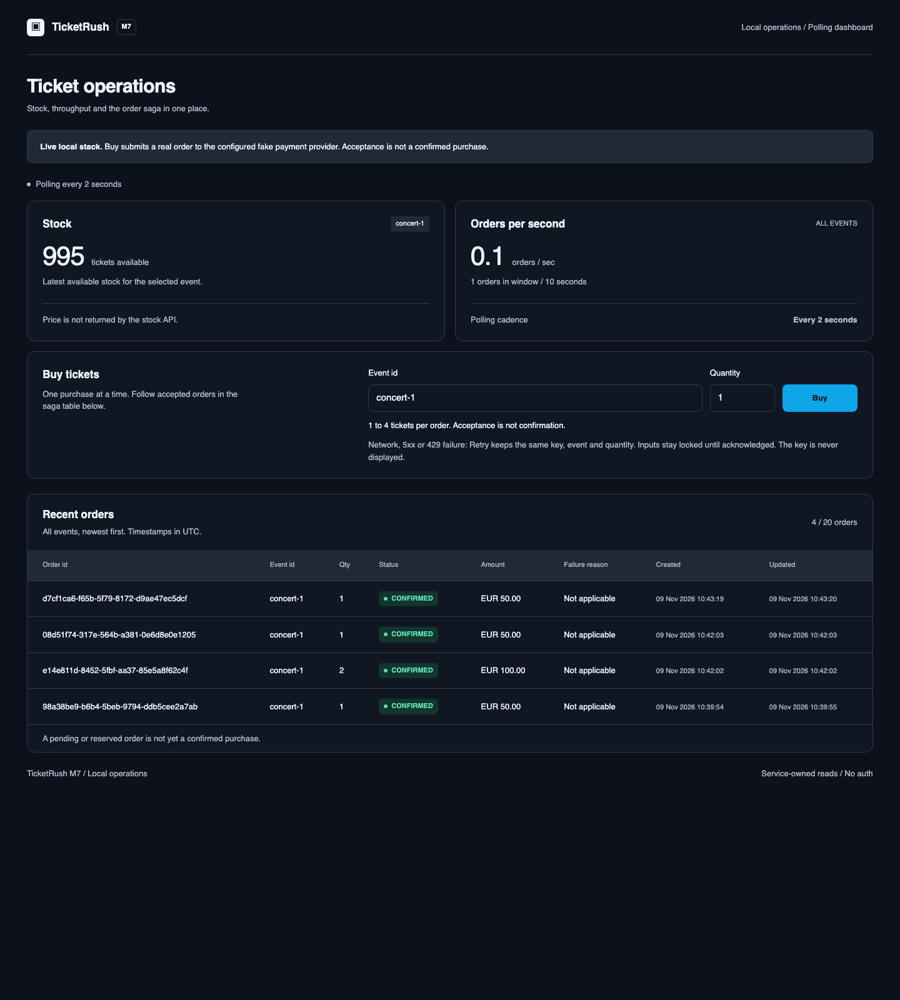
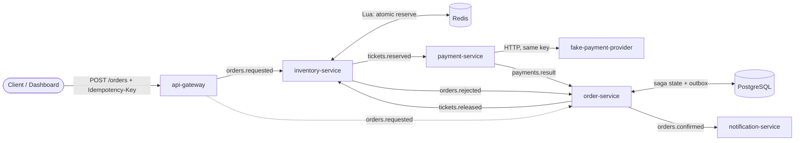
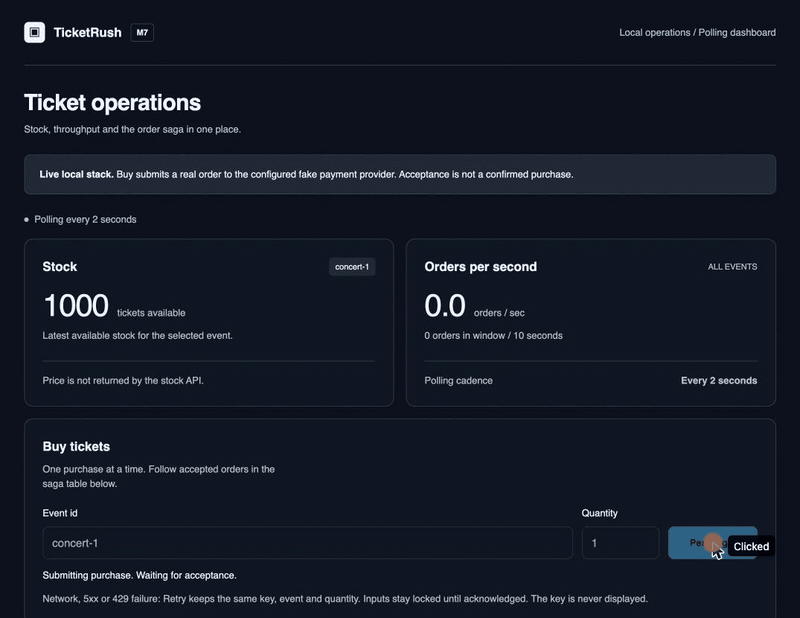

# TicketRush

A flash-sale ticketing platform built to show how to sell a limited stock under heavy load
without ever overselling or charging twice. Event-driven Java microservices on Kafka, run on
Kubernetes, then deliberately broken to measure what happens.

**The invariant:** never sell more tickets than exist, and never create or charge the same order
twice. Every design choice and every test below serves this sentence.

**Status:** feature complete: ordering saga, autoscaling on Kubernetes, chaos experiments and the
dashboard are all built and tested. Detailed
verification and known gaps: [docs/PROGRESS.md](docs/PROGRESS.md).



## Tech stack

| Layer | Technology |
|---|---|
| Language and framework | Java 21, Spring Boot 4.1.1, Spring Kafka 4.1 |
| Messaging | Apache Kafka 4.3.1 in KRaft mode (3 brokers, RF 3 on Kubernetes via Strimzi 1.3.0), 12 partitions per topic, dead-letter topics |
| Data | PostgreSQL 18.6 with Flyway migrations (orders, transactional outbox), Redis 8.10.2 with Lua scripts (atomic stock reservation) |
| Frontend | Angular 22.2.5 (single page dashboard), Vitest, served by unprivileged nginx |
| Runtime and delivery | Docker multi-stage images (non-root), Docker Compose, Kubernetes (kind 1.36), Helm chart |
| Autoscaling and observability | KEDA 2.21 (scales on Kafka lag), Micrometer, Prometheus 3.15, Grafana 13.3 |
| Testing | JUnit 5, AssertJ, Awaitility, Testcontainers 2.0.5, k6 2.3.0 (load), Vitest, SonarCloud |
| Build | Maven 3.9 multi-module reactor |

Exact pins and the reason for each: [docs/DESIGN.md](docs/DESIGN.md#1-versions).

## Architecture



Six services, six topics, each with a `.DLT` dead-letter twin. The order moves through a saga:
`PENDING`, `RESERVED`, then `CONFIRMED` or `FAILED` (declined payment, sold out or timeout). A
failure publishes `tickets.released` and inventory restocks once.

How the invariant is enforced:

- **One writer per event.** Messages are keyed by event id, so one event's stock is processed by a
  single consumer in order. Reservation is one atomic Redis Lua script: check and decrement together.
- **Idempotency end to end.** The gateway derives a deterministic order id from the client's
  `Idempotency-Key`. Every consumer dedupes by order id, and the payment provider is called with the
  same key, so a replay or a retry never reserves or charges twice.
- **Transactional outbox.** An order status change and the event it must publish commit in one
  database transaction; a relay publishes afterwards (at-least-once, deduped downstream).
- **Failure handling.** Retries with backoff, then dead-letter. A saga reaper times out stuck orders
  and releases their stock. Offsets are committed only after successful processing; SIGTERM is graceful.

## Proof, not claims

Every number below comes from a command that was run; the output is recorded in
[docs/PROGRESS.md](docs/PROGRESS.md) and raw files are under [docs/evidence/](docs/evidence/).

| Question | Result |
|---|---|
| 10,000 buyers, 1,000 concurrent duplicate requests, stock of 500 | Exactly 500 `CONFIRMED`, 9,500 `REJECTED`, 0 pending, stock 0, one charge each. Passed 10 runs out of 10 (`scripts/m2-acceptance.sh`) |
| Autoscaling under load (kind, k6, 8 orders/s) | Inventory and payment scaled 1 to 2 and back to 1. 960 acknowledged orders = 960 `CONFIRMED` = 960 charges; stock 12,000 = 11,040 left + 960 sold |
| Chaos experiments (19 completed audits) | Pod kills, a broker restart, about 30% payment declines and a database lock stall. Every audit kept the invariant: no oversell, no lost order, one charge per confirmed order. Settlement after a pod kill or broker restart took about 100 s including the remaining load |
| Automated tests | 239 tests, 0 failures in the last fully green run (unit, Testcontainers integration, end-to-end) |

Full table with every run, including failed and interrupted attempts, and the limits of what was
measured: [docs/CHAOS-RESULTS.md](docs/CHAOS-RESULTS.md).

## Run it

Requires Docker (with Compose) and `curl`. Nothing else for the local stack.

```sh
git clone https://github.com/phuong-le-tech/ticketrush.git
cd ticketrush
docker compose -f deploy/compose/docker-compose.yml up -d --build

# the Java services have no healthcheck, so wait until the read API answers
until curl -fs localhost:4200/api/events/concert-1/stock; do sleep 2; done
```

Open <http://localhost:4200> and press Buy, or use the API:

```sh
curl -i -X POST localhost:8080/orders \
  -H 'Content-Type: application/json' -H "Idempotency-Key: $(uuidgen)" \
  -d '{"eventId":"concert-1","customerId":"cust-1","quantity":1}'
# 202 {"orderId":"..."}, then the dashboard shows PENDING -> CONFIRMED and stock 1000 -> 999

docker compose -f deploy/compose/docker-compose.yml down -v   # stop and clean
```

`scripts/fresh-clone-check.sh` does exactly this from a fresh clone and fails if the order is not
confirmed within 60 seconds.

Kubernetes, Grafana, autoscaling and chaos experiments (need kind, Helm, kubectl, k6 and a Docker
VM of 16 GB for the consumer ramp): [docs/OPERATIONS.md](docs/OPERATIONS.md).

Run the tests (Java 21, Maven, Docker for Testcontainers):

```sh
export JAVA_HOME=$(/usr/libexec/java_home -v 21)   # macOS; use your JDK 21 path elsewhere
mvn verify                                          # about 15 minutes, starts real containers
```

## What I would do differently

Honest list of what is not done or not good enough. Details in [docs/PROGRESS.md](docs/PROGRESS.md).

- **Refunds.** A payment that succeeds after the order timed out is only logged. A real system
  needs a refund flow.
- **Redis is the source of truth for stock and has no durability** (no AOF, no replica). Losing it
  loses stock and dedupe state. I would persist reservations in PostgreSQL and treat Redis as a cache.
- **One hot key per show.** A single event uses one partition, so more inventory replicas do not
  help it (measured in the single-show comparison). A very large single show would need stock
  sharded across several keys.
- **Outbox relay has no backoff,** so one poisoned row can hold the rows behind it.
- **A database outage longer than about 7 seconds** dead-letters valid messages in order-service.
  I did not exercise this case.
- **No overload protection at the gateway.** The brief asked for 429 with `Retry-After`; it is
  not implemented, so the gateway relies on Kafka as its buffer.
- **No CI running the full suite.** Only SonarCloud runs on pull requests; the 15-minute
  Testcontainers suite runs locally.
- **Single node, single machine.** Everything was measured on one laptop (6 CPUs). The results
  show correctness under faults, not a capacity ceiling.

## Demo



Happy path only (four purchases, stock 1000 to 996). How it was recorded and a script for a second
clip about failure on kind: [docs/DEMO.md](docs/DEMO.md).

## Repository map

| Path | Content |
|---|---|
| `api-gateway`, `inventory-service`, `payment-service`, `order-service`, `notification-service`, `fake-payment-provider` | The six Spring Boot services |
| `common` | Event records, topic names, shared Kafka error handling |
| `dashboard` | Angular single page dashboard |
| `e2e-tests` | In-process end-to-end tests: purchase flow, oversell, replay, failures, dead-letter, metrics |
| `deploy/compose`, `deploy/helm/ticketrush` | Local stack and Kubernetes chart |
| `scripts` | Acceptance, chart checks, load and chaos runners |
| `docs` | [Spec](docs/SPEC.md), [design decisions](docs/DESIGN.md), [progress](docs/PROGRESS.md), [operations](docs/OPERATIONS.md), [chaos results](docs/CHAOS-RESULTS.md) |
