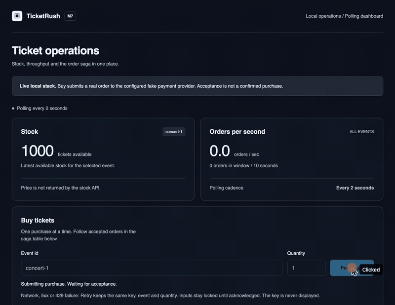

# TicketRush - Demo



The GIF above (`docs/design/demo/ticketrush-demo.gif`, 14 s) was recorded against the Compose stack on
2026-11-11: four purchases through the dashboard, stock going 1000 to 996, each order reaching
`CONFIRMED` in the saga table. It shows the happy path only. Failure and chaos behaviour is
documented with measurements in [CHAOS-RESULTS.md](CHAOS-RESULTS.md), not shown in this GIF.

## Re-record the GIF (about 15 seconds)

Needs Docker. The dashboard is only in Compose, not in the kind chart.

```sh
docker compose -f deploy/compose/docker-compose.yml down -v
docker compose -f deploy/compose/docker-compose.yml up -d --build
until curl -fs localhost:4200/api/events/concert-1/stock; do sleep 2; done
```

| Time | Action | What the viewer sees |
|---|---|---|
| 0:00 | Open <http://localhost:4200> | Stock 1000, 0.0 orders/s, empty order table |
| 0:02 | Click Buy once | "Order ... accepted ... not yet confirmed" (acceptance is not confirmation) |
| 0:05 | Scroll to Recent orders | Row goes `PENDING`, then `CONFIRMED`; stock 999 |
| 0:08 | Click Buy three more times, 3 s apart | Stock 998, 997, 996; orders per second rises |
| 0:14 | Stop | Four `CONFIRMED` rows, EUR 50.00 each |

## Optional second clip: failure on kind (about 60 seconds)

Not recorded. The chaos experiments run on kind with Grafana, not through the dashboard. Setup and
requirements (16 GB Docker VM): [OPERATIONS.md](OPERATIONS.md).

| Time | Command or action | What the viewer sees |
|---|---|---|
| 0:00 | `scripts/observability-up.sh` already done; open Grafana at `localhost:3000/d/ticketrush-m5` | Four panels: lag, processing time, orders per second, saga outcomes |
| 0:10 | `scripts/chaos.sh --experiment inventory-kill --runs 1` | k6 starts at 8 orders per second |
| 0:25 | The runner deletes an inventory pod | Orders per second dips, consumer lag rises |
| 0:45 | Pod is replaced | Lag drains, completion rate catches up |
| 1:00 | Runner prints its audit | Every acknowledged order settled, no oversell, one charge per confirmed order |
